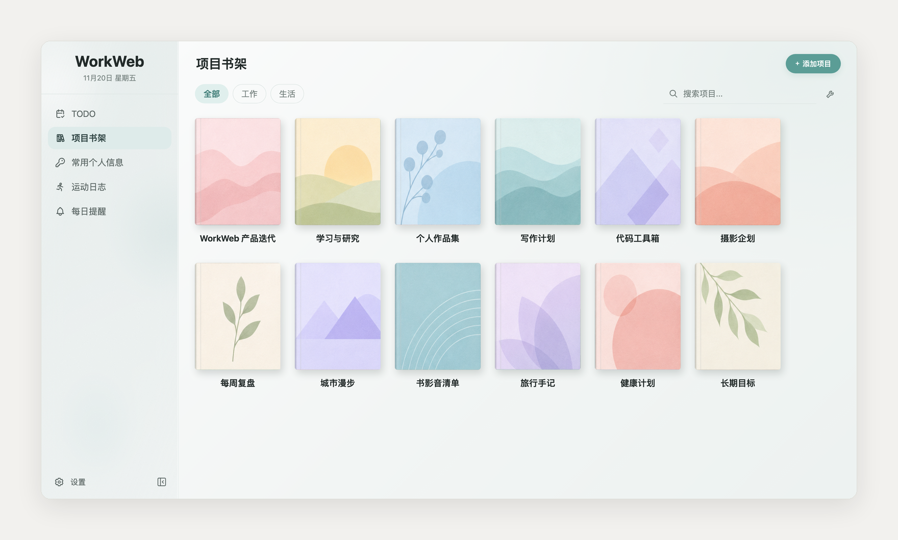
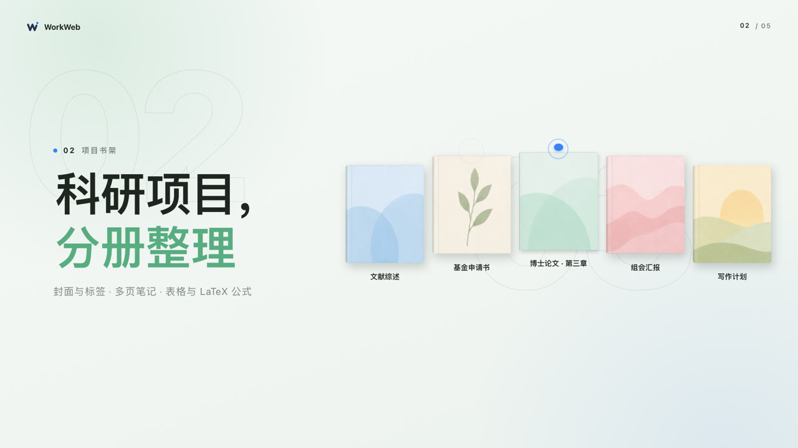

<h1 align="center">WorkWeb</h1>

<strong>把零散的事，收进自己的工作台。</strong>

本地存储 · 免费开源 · 无需注册

  <a href="https://github.com/SeanNg997/WorkWeb/releases">下载桌面版</a> ·
  <a href="#从源码启动">从源码启动</a>

随手记下今天的事，把长期项目写成一本书，也为运动和日常留一点位置。WorkWeb 将这些收在同一个个人面板里，让记录有去处，让注意力回到手头的事。

   
  点击封面观看 24 秒宣传片

## 从一张便笺，到一本项目书

| 你的日常 | WorkWeb 的安排 |
| --- | --- |
| 想法来了，先记下来 | **TODO 便笺**：卡片内直接编辑，支持 Markdown，拖动整理。 |
| 一个项目，慢慢做完 | **项目书架**：封面、标签与多页笔记，把计划、资料和过程放在一起。 |
| 常用信息，随取随用 | **个人信息**：按标签归类，自定义字段，一键复制。 |
| 每次运动，都有记录 | **运动日志**：日历记录训练，查看运动天数与指标趋势。 |
| 日常小事，坚持做完 | **每日提醒**：按天或指定星期重复，设置每日次数，记录完成进度。 |

项目写作支持可视化编辑与 Markdown 源码切换，也能插入图片、表格和 LaTeX 公式。浅绿、纸白、雾蓝、深色四款主题，换一种适合此刻的桌面。

## 开始使用

前往 [Releases](https://github.com/SeanNg997/WorkWeb/releases) 下载适合系统的安装包。桌面版首次启动时选择数据目录，即可开始记录。
